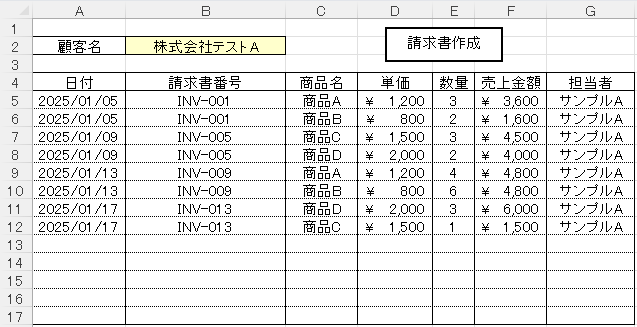

# vba-invoice-system-automation

## 概要
売上データがあるシートから顧客名を絞り込み、請求書シートへ明細を自動転記するマクロです。
手作業のコピー & ペーストを、ボタン1クリックに置き換えます。

> [!NOTE]
> `sample/invoice.xlsm` のデータはすべて架空であり、実在する企業・団体とは無関係です。

## 機能

| 機能 | 内容 | 実装 |
|:---|:---|:---|
| 明細の転記 | 選択した顧客の売上データをすべて請求書シートへ値として貼り付け | `CInvoice.CellPaste` |
| 絞り込み | 売上シートのC列(顧客名)でオートフィルタを適用 | `CInvoice.FilterOn` |
| 貼り付け前のクリア | 前回の明細(A5:G17)を消去してから転記 | `CInvoice.CellClear` |
| 実行ボタン | 図形にマクロを割り当て、クリックで実行 | `CreateInvoice.CreateInvoice` |

### エラー処理

| 条件 | 表示メッセージ |
|:---|:---|
| B2セルが空欄 | 顧客名の入力を促すエラー |
| B2の顧客名が売上データに存在しない | 「(顧客名)は売上リストの顧客名には存在しません」 |
| 売上シートにデータがない | 売上リストが存在しない旨のエラー |

## 実行結果


## 実行方法
1. ワークシート「請求書」B2セルの顧客名をプルダウンで選択（売上データ連動）
2. 「請求書作成」と書かれた図形（ボタン）をクリック
3. 該当する顧客名のデータが下の表（A5:G17）に転記されます
## ディレクトリ構成
```
invoice_system
├── image
│   └── result.png           # 実行結果画像
├── sample
│   └── invoice.xlsm         # Excelファイル（データ）
└── src
    ├── CInvoice.cls         # クラスモジュール
    └── CreateInvoice.bas    # 標準モジュール
```
## invoice.xlsmについて
- 全て架空のデータであり、実際の企業・団体とは無関係です。
